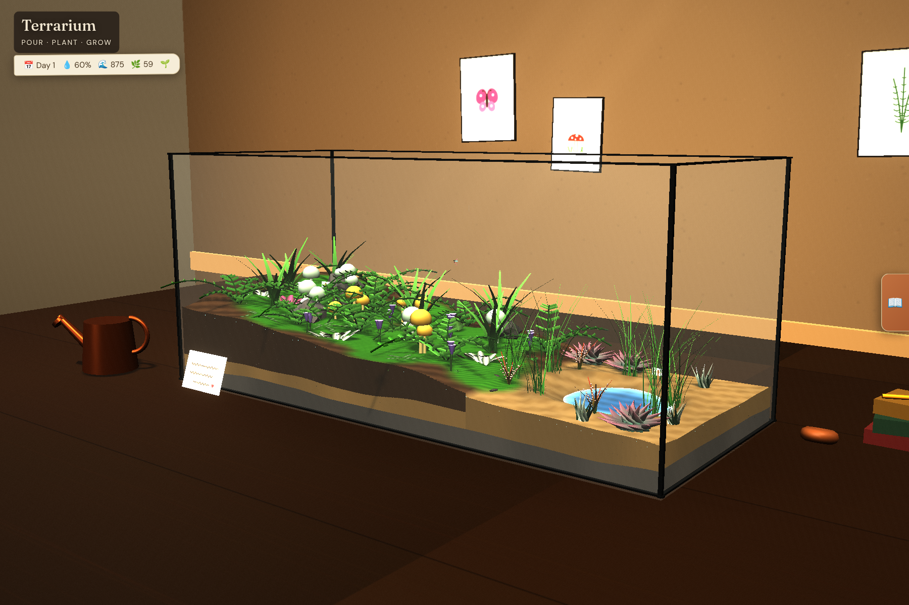

# Terrasim

Terrasim is a browser terrarium with editable soil, water and procedural plants. Pour a pond, plant around it, and come back to the same garden later.



[Play Terrasim](https://mottopanikeiku.github.io/terrasim/)

## Tending the garden

Open the journal bookmark on the right to choose a tool. Add sand, soil, gravel or water; plant ferns, succulents and mushrooms; scatter seeds, moss, rocks or leaf litter.

Plants grow, wilt when dry, recover when watered, and compost when they die. Water evaporates, raises humidity and condenses on the glass. The diary keeps track of the garden, and saves stay in your browser.

| Action | Mouse or touch | Keyboard |
| --- | --- | --- |
| Choose a tool | Open the journal and select a tool | Tab, then Enter |
| Pour or dig | Hold left mouse | Hold Space with the tank focused |
| Plant | Click or tap | Arrows move the target; Enter plants |
| Orbit | Right-drag; drag on touch | Shift + arrows |
| Zoom | Scroll | `+` / `−` |
| Fit the tank | | Home |
| Stop pouring | Release the mouse | Escape |

The Studio controls lighting, time speed and sound. It also takes PNG photos and resets the garden.

## Run locally

Use Node.js 22 and a WebGL-capable browser.

```sh
npm ci
npm run dev
```

Open the URL printed by Vite. To build and run the checks:

```sh
npm test
npm run build
npx playwright install chromium
npm run test:browser
```

The [world model](src/core/World.ts) handles terrain, moisture and plant lifecycles. [Procedural meshes](src/world/PlantMeshes.ts) draw each plant, while a separate render loop adapts resolution and shadows to the drawing load. Unit tests cover the world rules and saved state; browser tests cover editing, keyboard controls and the journal.

The terrain is a heightfield, so digging cannot make caves or overhangs. Plant care follows hand-tuned game rules. Saves are local to this browser.

## Credits

Built with [Three.js](https://threejs.org/), [Vite](https://vite.dev/) and synthesized [Web Audio](https://developer.mozilla.org/en-US/docs/Web/API/Web_Audio_API) sound. The interface uses Fraunces and DM Sans from Google Fonts. [MIT license](LICENSE).
