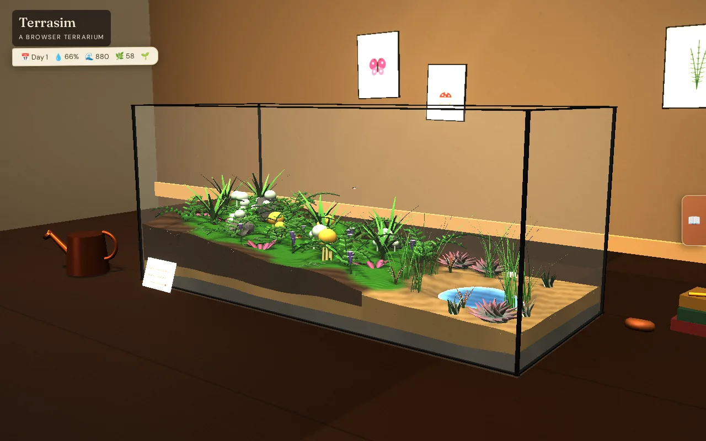
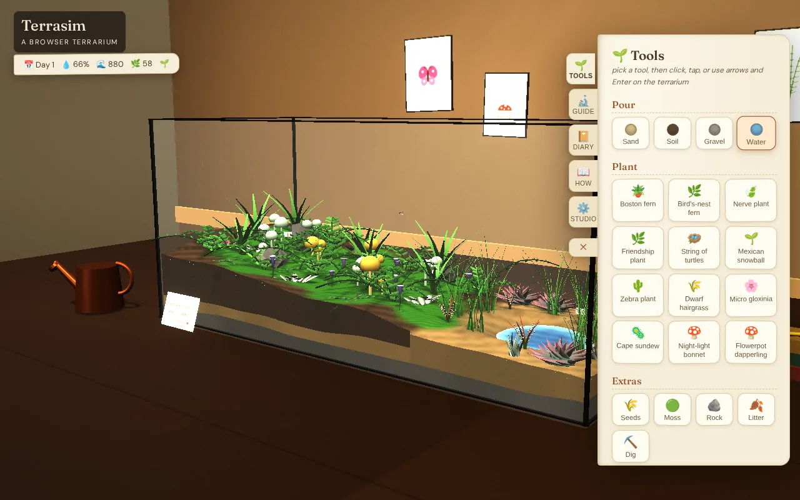
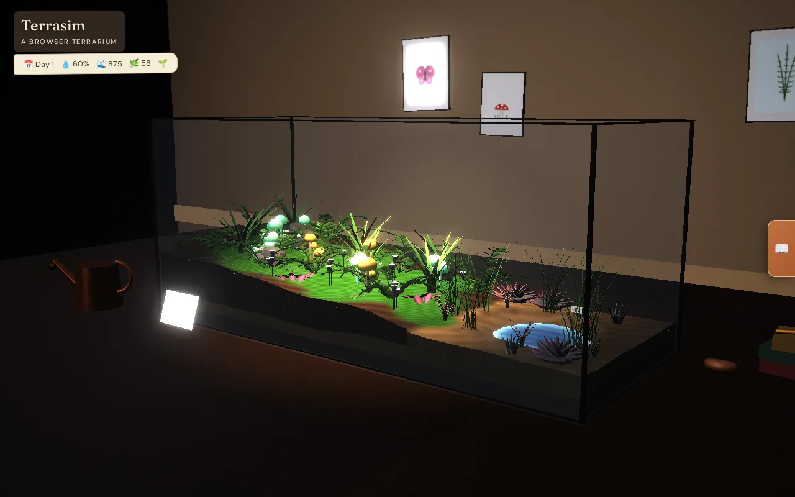

# Terrasim

A glass tank of soil, water and twelve plant species that runs [in the browser](https://mottopanikeiku.github.io/terrasim/) with Three.js. You pour layers of sand, soil and gravel, dig a pond and plant around it. The plants drink, wilt, recover, die and compost back into the soil. The garden is saved in the browser, and when you come back it fast-forwards through up to three days you were away.

[](https://mottopanikeiku.github.io/terrasim/)

<p>


</p>

## In the tank

- Sand, soil, gravel and water pour in layers, and the dig tool takes them back out.
- Twelve species, from Boston fern and string of turtles to a glowing mushroom.
- Seeds, moss, rocks and leaf litter.
- Water evaporates and fogs the glass.
- Pillbugs, snails, springtails and butterflies move in uninvited.
- Night mode brings out fireflies. You can also speed up time or save a photo of the tank.

| Action | Mouse or touch | Keyboard |
| --- | --- | --- |
| Pick a tool | Open the journal on the right | Tab, then Enter |
| Pour or dig | Hold left mouse; tap on touch | Hold Space on the tank |
| Plant | Click or tap | Arrows aim, Enter plants |
| Orbit / zoom | Right-drag, scroll | Shift + arrows, `+` / `−` |
| Fit the tank / stop pouring | | Home / Escape |

## How it works

The terrain is a heightfield, so there are no caves or overhangs. [`World.ts`](src/core/World.ts) holds soil, moisture and plant lifecycles, with care rules I tuned by hand. Each plant is a [procedural mesh](src/world/PlantMeshes.ts), and the sound is synthesized in Web Audio.

```sh
npm ci
npm run dev
```

Needs Node 22 and a browser with WebGL. `npm test` runs the unit tests and `npm run test:browser` the Playwright checks.

Built with [Three.js](https://threejs.org/) and [Vite](https://vite.dev/). The interface uses Fraunces and DM Sans from Google Fonts. [MIT license](LICENSE).
